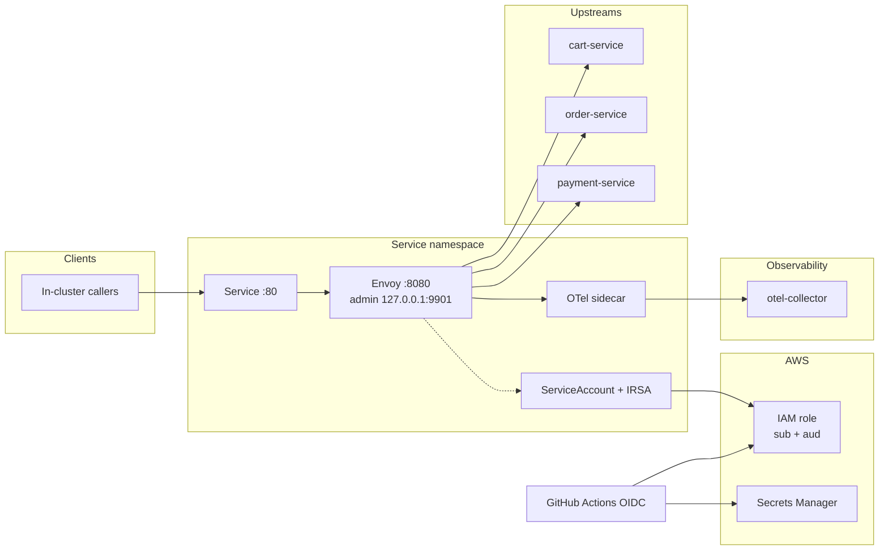

# platform-templates

Reusable Terraform modules and GitHub Actions workflows for platform engineering teams. Patterns covered: Envoy API gateway on EKS, OIDC workload identity (IRSA), service onboarding automation, and deploy-time secrets sync without long-lived cloud credentials.

The goal: make the safe path the easy path.

> These are **reference templates**. Wire them to your org’s cluster names, IAM boundaries, and observability backends before production use. Container image defaults are digest-pinned; tighten NetworkPolicies per environment.

## Contents

### Terraform modules

| Module | What it provisions |
|--------|--------------------|
| [`terraform/modules/api-gateway`](terraform/modules/api-gateway) | Envoy gateway on EKS with IRSA, OTel sidecar, PDB, and baseline NetworkPolicy |

### GitHub Actions workflows

| Workflow | What it does |
|----------|-------------|
| [`.github/workflows/service-onboarding.yml`](.github/workflows/service-onboarding.yml) | Namespace, IRSA ServiceAccount, OTel ConfigMap, smoke checks, runbook PR |
| [`.github/workflows/secrets-injection.yml`](.github/workflows/secrets-injection.yml) | Reusable workflow: OIDC → STS → Secrets Manager → Kubernetes Secret → rollout |
| [`.github/workflows/ci.yml`](.github/workflows/ci.yml) | `terraform fmt` / `validate` / `test`, TFLint, Checkov, actionlint, action SHA pins, Floci apply |

### Examples

| Example | Purpose |
|---------|---------|
| [`examples/api-gateway`](examples/api-gateway) | Root-module composition used by CI `terraform validate` |
| [`examples/template-render`](examples/template-render) | Renders Envoy/OTel templates without cloud providers |
| [`examples/floci-aws`](examples/floci-aws) | Floci apply fixture for IRSA IAM + Secrets Manager (no K8s) |

---

## Architecture



Deploy-time secrets follow OIDC → STS → Secrets Manager → Kubernetes Secret (see the secrets-injection workflow). Prefer External Secrets Operator for continuous sync.

---

## API Gateway module

Provisions an Envoy Proxy API gateway on EKS with:

- IRSA (OIDC) workload identity — trust policy scoped by `sub` and `aud`
- OpenTelemetry sidecar (OTLP ingest + Envoy metrics scrape on loopback)
- PodDisruptionBudget and rolling updates with `maxUnavailable=0`
- Configurable per-route timeouts, retries, and upstream ports
- Hardened pod security context; Envoy admin bound to localhost only
- Digest-pinned Envoy / OTel images by default (`@sha256:…` required)

```hcl
module "api_gateway" {
  source = "./terraform/modules/api-gateway"

  service_name    = "checkout"
  namespace       = "checkout"
  oidc_issuer_url = "https://oidc.eks.us-west-2.amazonaws.com/id/EXAMPLE"
  replicas        = 3

  routes = [
    { prefix = "/api/v1/cart", cluster = "cart-service", timeout_s = 10 },
    { prefix = "/api/v1/order", cluster = "order-service", timeout_s = 30, retries = 2 },
    { prefix = "/api/v1/payment", cluster = "payment-service", port = 8080, timeout_s = 45, retries = 0 },
  ]

  otel_exporter_endpoint = "otel-collector.observability.svc.cluster.local:4317"

  tags = {
    Environment = "staging"
    Team        = "payments"
  }
}
```

Full input/output reference: [`terraform/modules/api-gateway/README.md`](terraform/modules/api-gateway/README.md).

---

## Service onboarding workflow

Replaces a multi-day “get a service onto the platform” checklist with one workflow run.

**In one run it:**

1. Validates service name, team slug, and SLO target  
2. Creates/labels the namespace and an IRSA-annotated ServiceAccount  
3. Deploys an OTel ConfigMap with service metadata  
4. Smoke-checks those resources  
5. Opens a PR with a runbook stub  

**Required repository secrets:** `AWS_PLATFORM_ROLE_ARN`, `AWS_REGION`, `AWS_ACCOUNT_ID`, `EKS_OIDC_PROVIDER` (e.g. `oidc.eks.us-west-2.amazonaws.com/id/EXAMPLE`), `OTEL_EXPORTER_ENDPOINT`

```yaml
# Trigger from the Actions UI or repository_dispatch (type: onboard-service)
workflow_dispatch:
  inputs:
    service_name: "checkout-api"
    team_slug:    "payments-team"
    slo_target:   "0.999"
    environment:  "staging"
```

---

## Secrets injection workflow

Deploy-time pattern (no long-lived `AWS_SECRET_ACCESS_KEY` in GitHub):

```
GitHub OIDC token → AWS STS AssumeRoleWithWebIdentity → scoped IAM role → Secrets Manager
                 → Kubernetes Secret (stringData via stdin) → Deployment envFrom → rollout
```

Sessions default to 15 minutes and use a per-run role session name. Prefer [External Secrets Operator](https://external-secrets.io/) or the Secrets Store CSI driver for continuous sync; this workflow covers deploy-time bootstrap.

```yaml
# From a service repo deploy workflow
jobs:
  deploy:
    uses: your-org/platform-templates/.github/workflows/secrets-injection.yml@main
    with:
      service_name: checkout-api
      environment:  production
    secrets:
      AWS_DEPLOY_ROLE_ARN: ${{ secrets.AWS_DEPLOY_ROLE_ARN }}
      AWS_REGION:          ${{ secrets.AWS_REGION }}
```

---

## Local checks

```bash
terraform fmt -check -recursive terraform examples
cd terraform/modules/api-gateway && terraform init -backend=false && terraform validate && terraform test
cd examples/api-gateway && terraform init -backend=false && terraform validate
tflint --init && tflint --chdir terraform/modules/api-gateway
checkov -d . --config-file .checkov.yml
make check-action-pins          # third-party uses: must be 40-char SHAs
make test-check-action-pins     # unit tests for the pin checker
```

---

## Local testing with Floci

[Floci](https://github.com/floci-io/floci) is a free local AWS emulator (no AWS account or token). CI runs a separate **Floci apply** job so emulator gaps cannot block fmt / validate / TFLint / Checkov / actionlint.

```bash
make test-floci   # docker pull pinned Floci → apply → assert → destroy
```

| Module / workflow piece | Floci apply coverage |
|-------------------------|----------------------|
| `aws_iam_role` (IRSA trust `sub`+`aud`) | **Covered** via `examples/floci-aws` |
| `aws_iam_role_policy_attachment` | **Covered** (fixture attaches `ReadOnlyAccess`) |
| `data.aws_caller_identity` / STS | **Covered** |
| Secrets Manager secret + `get-secret-value` (secrets-injection pattern) | **Covered** (fixture; not provisioned by the module) |
| `aws_iam_openid_connect_provider` | **Not created** by the module (ARN string only) |
| All `kubernetes_*` resources | **Unsupported here** — stay on validate / `terraform test` / template-render |
| EKS cluster / live kube API | **Unsupported here** |

Image pin: `floci/floci:2.4.0@sha256:5ee85db604c4aa74ac76e07ea5cc83086f37bb472bf3dbb97e34019e48efae9c` (override with `FLOCI_IMAGE`).

---

## Image and base-OS patch cadence

Digest pinning stops surprise pulls; it does **not** stop known CVEs in the pinned bits (e.g. base-image OpenSSH bugs). Treat digests as a lockfile that must be refreshed on purpose.

| Artifact | Where pinned | Who bumps | Cadence |
|----------|--------------|-----------|---------|
| Envoy / OTel Collector images | `terraform/modules/api-gateway/variables.tf` (`@sha256:…`, validation rejects unpinned overrides) | Platform maintainers (PR) | Monthly, and within 7 days of a relevant CVE advisory |
| Floci emulator image | `scripts/test-floci.sh` (`FLOCI_IMAGE`, digest) | Platform maintainers | When bumping the Floci apply job or on Floci security notes |
| Third-party GitHub Actions | `.github/workflows/*.yml` (`@<40-char-sha> # tag`) | Dependabot (`github-actions` in `.github/dependabot.yml`) + human review | Weekly Dependabot; merge after CI green |

**How to bump a container digest:** pull the intended tag, record `RepoDigest` / `sha256:…`, update the default in `variables.tf` (keep a readable tag prefix), run `terraform test` / module validate, open a PR. Do not “unpin to latest” to pick up patches.

**Ownership:** the platform team that merges to this repo owns the cadence above. Service teams consuming these templates should inherit the same digests or document their own refresh policy.

---

## Philosophy

- **OIDC everywhere** — no long-lived cloud credentials in CI or on pods  
- **OTel by default** — new services get trace/metric wiring on day one  
- **Onboarding is a product** — time-to-safe-production is a platform metric  
- **Safe by default** — PDBs, `maxUnavailable=0`, localhost admin, digest-pinned images, SHA-pinned third-party Actions (`owner/action@<40-char-sha> # tag`), IRSA `aud`+`sub`, smoke checks before success  

## Contributing

PRs welcome. Each Terraform module should include:

- `main.tf` (resources), `variables.tf`, `outputs.tf`, `versions.tf`
- `README.md` with a usage example
- Templates under `templates/` when ConfigMaps are rendered
- Tests under `tests/*.tftest.hcl` where practical
- CI coverage via `terraform validate` / `terraform test`, TFLint, and Checkov (see `.github/workflows/ci.yml`)
