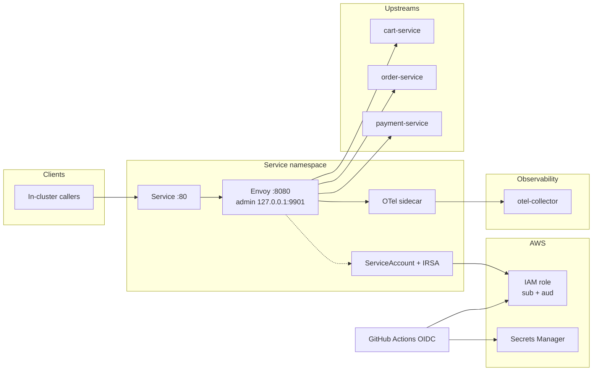

# platform-templates

Reusable Terraform modules and GitHub Actions workflows for platform engineering teams. Patterns covered: Envoy API gateway on EKS, OIDC workload identity (IRSA), service onboarding automation, and deploy-time secrets sync without long-lived cloud credentials.

The goal: make the safe path the easy path.

> These are **reference templates**. Wire them to your org’s cluster names, IAM boundaries, and observability backends before production use. Container image defaults are digest-pinned; tighten NetworkPolicies per environment.

## Contents

### Terraform modules

| Module | What it provisions |
|--------|--------------------|
| [`terraform/modules/api-gateway`](terraform/modules/api-gateway) | Envoy gateway on EKS with IRSA, OTel sidecar, PDB, and baseline NetworkPolicy |
| [`terraform/modules/vendor-trust`](terraform/modules/vendor-trust) | Cross-account vendor role requiring `sts:ExternalId` and exactly one of `aws:SourceIp` or `aws:SourceVpce` (`aws:PrincipalOrgID` is optional and additive). No attached permissions |

### GitHub Actions workflows

| Workflow | What it does |
|----------|-------------|
| [`.github/workflows/service-onboarding.yml`](.github/workflows/service-onboarding.yml) | Namespace, IRSA ServiceAccount, OTel ConfigMap, smoke checks, runbook PR |
| [`.github/workflows/secrets-injection.yml`](.github/workflows/secrets-injection.yml) | Reusable workflow: OIDC → STS → Secrets Manager → Kubernetes Secret → rollout |
| [`.github/workflows/ci.yml`](.github/workflows/ci.yml) | `terraform fmt` / `validate` / `test` (api-gateway and vendor-trust), vendor-trust example validate, template render, TFLint, Checkov, actionlint, action SHA pins, GitHub OIDC `sub`/`aud` check, Floci apply |

### Examples

| Example | Purpose |
|---------|---------|
| [`examples/api-gateway`](examples/api-gateway) | Root-module composition used by CI `terraform validate` |
| [`examples/vendor-trust`](examples/vendor-trust) | Validates the vendor-trust module with an example (non-secret) external id and one documentation CIDR. No apply |
| [`examples/github-oidc-role`](examples/github-oidc-role) | GitHub Actions OIDC trust policy with one repository and ref as `sub`. The policy `scripts/check-oidc-trust.sh` must find |
| [`examples/template-render`](examples/template-render) | Renders Envoy/OTel templates without cloud providers |
| [`examples/floci-aws`](examples/floci-aws) | Floci apply fixture for IRSA IAM + Secrets Manager (no K8s) |

---

## Architecture



Deploy-time secrets follow OIDC → STS → Secrets Manager → Kubernetes Secret (see the secrets-injection workflow). Prefer External Secrets Operator for continuous sync.

---

## API Gateway module

Provisions an Envoy Proxy API gateway on EKS with:

- IRSA (OIDC) workload identity — trust policy scoped by `sub` and `aud`
- OpenTelemetry sidecar (OTLP ingest + Envoy metrics scrape on loopback)
- PodDisruptionBudget and rolling updates with `maxUnavailable=0`
- Configurable per-route timeouts, retries, and upstream ports
- Hardened pod security context; Envoy admin bound to localhost only
- Digest-pinned Envoy / OTel images by default (`@sha256:…` required)

```hcl
module "api_gateway" {
  source = "./terraform/modules/api-gateway"

  service_name    = "checkout"
  namespace       = "checkout"
  oidc_issuer_url = "https://oidc.eks.us-west-2.amazonaws.com/id/EXAMPLE"
  replicas        = 3

  routes = [
    { prefix = "/api/v1/cart", cluster = "cart-service", timeout_s = 10 },
    { prefix = "/api/v1/order", cluster = "order-service", timeout_s = 30, retries = 2 },
    { prefix = "/api/v1/payment", cluster = "payment-service", port = 8080, timeout_s = 45, retries = 0 },
  ]

  otel_exporter_endpoint = "otel-collector.observability.svc.cluster.local:4317"

  tags = {
    Environment = "staging"
    Team        = "payments"
  }
}
```

Full input/output reference: [`terraform/modules/api-gateway/README.md`](terraform/modules/api-gateway/README.md).

---

## Vendor trust module

Cross-account role for a third-party vendor. The trust policy requires `sts:ExternalId` and exactly one of `aws:SourceIp` (valid CIDRs, no `/0`) or `aws:SourceVpce`; `principal_org_id` only adds `aws:PrincipalOrgID` next to one of them. `tags` must carry non-empty `team`, `service`, and `env`. Requires Terraform 1.7.0 or later.

```hcl
module "vendor" {
  source            = "./terraform/modules/vendor-trust"
  vendor_account_id = "111122223333"
  external_id       = "acme-7f3a9c1e-prod"
  source_ip_cidrs   = ["203.0.113.0/24"]

  tags = {
    team    = "platform"
    service = "vendor-bridge"
    env     = "prod"
  }
}
```

Inputs, outputs, and validation rules: [`terraform/modules/vendor-trust/README.md`](terraform/modules/vendor-trust/README.md). Rationale: [`docs/vendor-access.md`](docs/vendor-access.md). Related: [agent workload isolation](docs/agent-workload-isolation.md).

---

## Service onboarding workflow

Replaces a multi-day “get a service onto the platform” checklist with one workflow run.

**In one run it:**

1. Validates service name, team slug, and SLO target  
2. Creates/labels the namespace and an IRSA-annotated ServiceAccount  
3. Deploys an OTel ConfigMap with service metadata  
4. Smoke-checks those resources  
5. Opens a PR with a runbook stub  

**Required repository secrets:** `AWS_PLATFORM_ROLE_ARN`, `AWS_REGION`, `AWS_ACCOUNT_ID`, `EKS_OIDC_PROVIDER` (e.g. `oidc.eks.us-west-2.amazonaws.com/id/EXAMPLE`), `OTEL_EXPORTER_ENDPOINT`

```yaml
# Trigger from the Actions UI or repository_dispatch (type: onboard-service)
workflow_dispatch:
  inputs:
    service_name: "checkout-api"
    team_slug:    "payments-team"
    slo_target:   "0.999"
    environment:  "staging"
```

---

## Secrets injection workflow

Deploy-time pattern (no long-lived `AWS_SECRET_ACCESS_KEY` in GitHub):

```
GitHub OIDC token → AWS STS AssumeRoleWithWebIdentity → scoped IAM role → Secrets Manager
                 → Kubernetes Secret (stringData via stdin) → Deployment envFrom → rollout
```

Sessions default to 15 minutes and use a per-run role session name. Prefer [External Secrets Operator](https://external-secrets.io/) or the Secrets Store CSI driver for continuous sync; this workflow covers deploy-time bootstrap. The caller job grants `id-token: write` and `contents: read`, the same scopes the `deploy` job declares.

```yaml
# From a service repo deploy workflow
jobs:
  deploy:
    permissions:
      id-token: write
      contents: read
    uses: your-org/platform-templates/.github/workflows/secrets-injection.yml@main
    with:
      service_name: checkout-api
      environment:  production
    secrets:
      AWS_DEPLOY_ROLE_ARN: ${{ secrets.AWS_DEPLOY_ROLE_ARN }}
      AWS_REGION:          ${{ secrets.AWS_REGION }}
```

---

## Workflow token permissions

Each workflow sets `permissions: {}`. A job receives only the scopes listed on that job.

| Workflow | Job | Permissions | Used for |
|----------|-----|-------------|----------|
| [`ci.yml`](.github/workflows/ci.yml) | `terraform` | `contents: read` | Checkout |
| [`ci.yml`](.github/workflows/ci.yml) | `tflint` | `contents: read` | Checkout |
| [`ci.yml`](.github/workflows/ci.yml) | `checkov` | `contents: read` | Checkout |
| [`ci.yml`](.github/workflows/ci.yml) | `workflow-lint` | `contents: read` | Checkout |
| [`ci.yml`](.github/workflows/ci.yml) | `action-pins` | `contents: read` | Checkout |
| [`ci.yml`](.github/workflows/ci.yml) | `oidc-trust` | `contents: read` | Checkout |
| [`ci.yml`](.github/workflows/ci.yml) | `floci-apply` | `contents: read` | Checkout |
| [`service-onboarding.yml`](.github/workflows/service-onboarding.yml) | `validate` | `{}` | Input checks only |
| [`service-onboarding.yml`](.github/workflows/service-onboarding.yml) | `bootstrap-identity` | `id-token: write`, `contents: read` | OIDC assume-role. Job token includes contents read. |
| [`service-onboarding.yml`](.github/workflows/service-onboarding.yml) | `bootstrap-observability` | `id-token: write`, `contents: read` | OIDC assume-role. Job token includes contents read. |
| [`service-onboarding.yml`](.github/workflows/service-onboarding.yml) | `smoke-test` | `id-token: write`, `contents: read` | OIDC assume-role. Job token includes contents read. |
| [`service-onboarding.yml`](.github/workflows/service-onboarding.yml) | `generate-runbook` | `contents: write`, `pull-requests: write` | Checkout, push the runbook branch, `gh pr create` |
| [`secrets-injection.yml`](.github/workflows/secrets-injection.yml) | `deploy` | `id-token: write`, `contents: read` | OIDC assume-role and checkout |

Supply-chain assumptions for these workflows: [CI threat model](docs/ci-threat-model.md).

## Local checks

The validation gate is one command:

```bash
bash scripts/check.sh
```

It runs the agent-misbehavior and assertion helpers, then `scripts/checks/shell.sh`: shellcheck, the repo shell tests (`test-check-action-pins`, `test-check-oidc-trust`, `test-docs-claims`, `test-terraform-config`), `check-action-pins.sh`, `check-oidc-trust.sh --skip-testdata --require-match`, `terraform fmt -check -recursive terraform examples`, `terraform test` for every module with tests (api-gateway and vendor-trust, run in a temp copy so `terraform init` does not touch the tree), and the Floci apply (`scripts/test-floci.sh`) when a docker daemon is available. A stage whose tool is missing prints `*** SKIP ***` and fails the gate unless `ALLOW_SKIP=1` is set. Set `TF_BIN` to use a specific terraform binary (CI pins 1.9.8). Without docker, `test-floci` is skipped, not passed.

TFLint and Checkov are CI-only (`tflint` and `checkov` jobs in `ci.yml`, via their GitHub Actions); `scripts/check.sh` does not run them. CI TFLint lints `terraform/modules/api-gateway` and `examples/api-gateway`, not vendor-trust. To run the same tools by hand:

```bash
terraform fmt -check -recursive terraform examples
cd terraform/modules/api-gateway && terraform init -backend=false && terraform validate && terraform test
cd terraform/modules/vendor-trust && terraform init -backend=false && terraform test
cd examples/api-gateway && terraform init -backend=false && terraform validate
cd examples/vendor-trust && terraform init -backend=false && terraform validate
tflint --init && tflint --chdir terraform/modules/api-gateway
checkov -d . --config-file .checkov.yml
make check-action-pins          # third-party uses: must be 40-char SHAs
make test-check-action-pins     # unit tests for the pin checker
make check-oidc-trust           # GitHub OIDC trust policies in the repo
make test-check-oidc-trust      # unit tests for that checker
make test-terraform-config      # vendor-trust version floor, lock hashes, --require-match wiring
make test-docs-claims           # greps docs for claims a review found wrong
```

Lock files: `terraform/modules/vendor-trust` and `examples/vendor-trust` list two `h1:` hashes for the `aws` provider. The other lock files (`terraform/modules/api-gateway`, `examples/api-gateway`, `examples/floci-aws`) list one per provider; `examples/api-gateway` has a single platform hash per provider.

### GitHub OIDC trust check

`scripts/check-oidc-trust.sh [--require-match] [--skip-testdata] [root]` scans `.json`, `.json.tpl`, `.tf`, and `.hcl` files that name `token.actions.githubusercontent.com`. JSON goes through `jq`; `.tf` and `.hcl` are first converted to JSON by an awk tokenizer that reads `jsonencode({...})` literals and `aws_iam_policy_document` blocks. Every Allow statement needs a `sub` and an `aud` condition under `StringEquals` or `StringLike` (case-insensitive, `ForAnyValue:` allowed) whose values are non-empty and contain no `*` or `?`. `StringNot*`, `ForAllValues:`, and `...IfExists` fail, as does any `.tf` or `.hcl` file where `:sub` appears in a form the tokenizer cannot classify (a `format()` key, a heredoc, a `dynamic` block). `Deny` statements are not checked. Exit codes: 0 pass, 1 findings, 2 usage or read error. `--require-match` makes a scan that finds no matching file exit 1 (without it, exit 0). `--skip-testdata` skips directories named `testdata`; without it they are scanned. CI and `make check-oidc-trust` pass both flags. It reads source files, not `terraform show -json` output, and needs `jq` and `awk`.

---

## Local testing with Floci

[Floci](https://github.com/floci-io/floci) is a free local AWS emulator (no AWS account or token). CI runs a separate **Floci apply** job so emulator gaps cannot block fmt / validate / TFLint / Checkov / actionlint.

```bash
make test-floci   # docker pull pinned Floci → apply → assert → destroy
```

| Module / workflow piece | Floci apply coverage |
|-------------------------|----------------------|
| `aws_iam_role` (IRSA trust `sub`+`aud`) | **Covered** via `examples/floci-aws` |
| `aws_iam_role_policy_attachment` | **Covered** (fixture attaches `ReadOnlyAccess`) |
| `data.aws_caller_identity` / STS | **Covered** |
| Secrets Manager secret + `get-secret-value` (secrets-injection pattern) | **Covered** (fixture; not provisioned by the module) |
| `aws_iam_openid_connect_provider` | **Not created** by the module (ARN string only) |
| All `kubernetes_*` resources | **Unsupported here** — stay on validate / `terraform test` / template-render |
| EKS cluster / live kube API | **Unsupported here** |

Image pin: `floci/floci:2.4.0@sha256:5ee85db604c4aa74ac76e07ea5cc83086f37bb472bf3dbb97e34019e48efae9c` (override with `FLOCI_IMAGE`).

---

## Image and base-OS patch cadence

Digest pinning stops surprise pulls; it does **not** stop known CVEs in the pinned bits (e.g. base-image OpenSSH bugs). Treat digests as a lockfile that must be refreshed on purpose.

| Artifact | Where pinned | Who bumps | Cadence |
|----------|--------------|-----------|---------|
| Envoy / OTel Collector images | `terraform/modules/api-gateway/variables.tf` (`@sha256:…`, validation rejects unpinned overrides) | Platform maintainers (PR) | Monthly, and within 7 days of a relevant CVE advisory |
| Floci emulator image | `scripts/test-floci.sh` (`FLOCI_IMAGE`, digest) | Platform maintainers | When bumping the Floci apply job or on Floci security notes |
| Third-party GitHub Actions | `.github/workflows/*.yml` (`@<40-char-sha> # tag`) | Dependabot (`github-actions` in `.github/dependabot.yml`) + human review | Weekly Dependabot; merge after CI green |

`.github/dependabot.yml` also watches the Terraform providers in `terraform/modules/api-gateway` and `examples/api-gateway`. It has no entry for `vendor-trust` or its example.

**How to bump a container digest:** pull the intended tag, record `RepoDigest` / `sha256:…`, update the default in `variables.tf` (keep a readable tag prefix), run `terraform test` / module validate, open a PR. Do not “unpin to latest” to pick up patches.

**Ownership:** the platform team that merges to this repo owns the cadence above. Service teams consuming these templates should inherit the same digests or document their own refresh policy.

---

## Philosophy

- **OIDC everywhere** — no long-lived cloud credentials in CI or on pods  
- **OTel by default** — new services get trace/metric wiring on day one  
- **Onboarding is a product** — time-to-safe-production is a platform metric  
- **Safe by default** — PDBs, `maxUnavailable=0`, localhost admin, digest-pinned images, SHA-pinned third-party Actions (`owner/action@<40-char-sha> # tag`), workflow `permissions: {}` with per-job token scopes, IRSA `aud`+`sub`, smoke checks before success  

## Contributing

PRs welcome. Each Terraform module should include:

- `main.tf` (resources), `variables.tf`, `outputs.tf`, `versions.tf`
- `README.md` with a usage example, requirements, and inputs/outputs tables (maintained by hand; no `terraform-docs`)
- Templates under `templates/` when ConfigMaps are rendered
- Tests under `tests/*.tftest.hcl` where practical
- CI coverage via `terraform validate` / `terraform test`, TFLint, and Checkov (see `.github/workflows/ci.yml`), and a pass of `bash scripts/check.sh`
